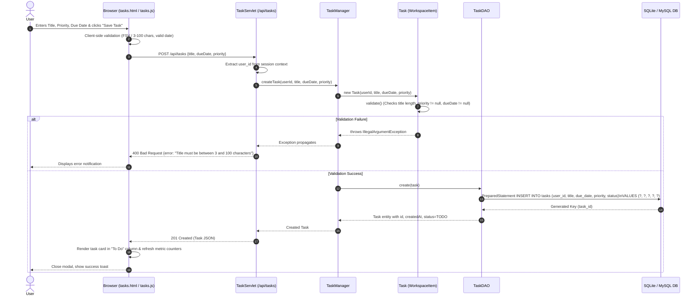

# FlowSpace – Add New Task Sequence Diagram
**Owner:** Member 3 (Hishal Hamza)  
**Components:** Browser (`tasks.html` & `tasks.js`) → `TaskServlet` (`/api/tasks`) → `TaskManager` → `Task` → `TaskDAO` → SQLite/MySQL Database

